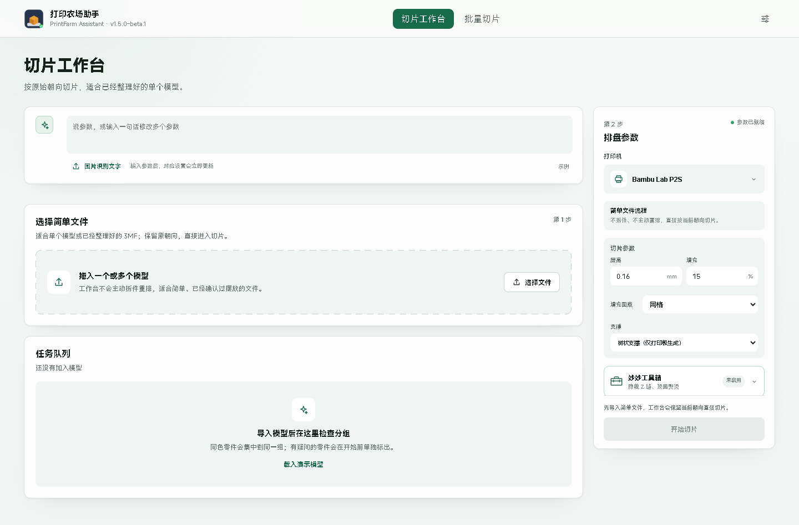

# PrintFarm Assistant / 打印农场助手

面向 Bambu Studio 用户和打印农场的 Windows 桌面切片工作台。它把批量导入、参数修改、切片、摆盘和输出检查放进一个本地工作区，适合重复处理大量模型。

> 打印农场助手是非官方项目，与 Bambu Lab 无隶属、合作或授权关系。Bambu Studio 和打印机固件需由用户自行安装与维护。

<p align="center">
  <a href="https://github.com/Bronove/printfarm-assistant/releases/latest">
    
  </a>
</p>



## 下载

请从 [Releases](https://github.com/Bronove/printfarm-assistant/releases) 下载
`PrintFarmAssistant-v1.5.0-beta.1-win64-setup.exe`。

当前测试版提供：

- 切片工作台：导入 STL、3MF、STEP/STP，直接生成可打印的 `.gcode.3mf`。
- 批量切片：一次处理多个模型，并保留同名文件所在的子目录。
- 普通自动摆盘、自动朝向、克隆和高级 Bambu 参数。
- 最省空间与最少支撑，由随安装包提供的闭源优化组件执行。
- 全部配置、日志、OCR 和使用记录保存在本机，不上传遥测。

公开基础代码使用 [MIT License](LICENSE)。多色排盘、手办模式和悬浮助手不包含在本次公开版本中；最省空间、最少支撑和 Bambu 桌面自动化组件保持闭源。

## 系统要求

| 项目 | 要求 |
| --- | --- |
| 系统 | Windows 10 1809 x64 或 Windows 11 x64 |
| 运行库 | Microsoft Edge WebView2 Runtime |
| 切片器 | 用户自行安装的 Bambu Studio |
| 权限 | 普通用户权限，不需要管理员/UAC |

详见 [安装说明](docs/INSTALL.md) 和 [兼容性](docs/COMPATIBILITY.md)。

## 安装说明

双击安装包即可。默认安装到：

```text
%LOCALAPPDATA%\Programs\PrintFarmAssistant
```

安装器只关闭正在运行的打印农场助手，不会关闭 Bambu Studio。升级时会识别并迁移旧版 `拓竹助手1.0`、`拓竹助手` 和 `拓竹助手V2` 的数据，然后清理旧快捷方式。

安装包当前没有代码签名，因此 Windows SmartScreen 可能显示“未知发布者”。请只从本仓库 Releases 下载，并用发布页给出的 SHA-256 校验文件。

## 数据与隐私

用户数据默认位于：

```text
%LOCALAPPDATA%\PrintFarmAssistant
```

程序不会上传模型、切片结果、日志或使用统计。详见 [隐私说明](docs/PRIVACY.md)。

## 从源码构建

公开源码不包含闭源优化器和自动化桥。构建基础工作台请阅读
[构建说明](docs/BUILDING.md)。

## 许可与品牌

基础代码采用 MIT 许可证。MIT 不授权使用“打印农场助手 / PrintFarm Assistant”的名称、Logo、图标、宣传图和官方发布身份；详见 [NOTICE](NOTICE.md)。第三方组件许可见
[THIRD_PARTY_NOTICES](THIRD_PARTY_NOTICES.md)。

## 安全

项目不会要求 GitHub 密码、支付密码、OTP 或 Bambu Studio 访问码。发现安全问题请按 [SECURITY](SECURITY.md) 私下报告。

## 支持开发

软件保持免费，个人和打印农场可免费使用并销售打印成品。当前公开测试版不设置付费墙，也不要求登录或激活。

正式发布后，爱发电链接或收款码会直接展示在 README 的这一节，不需要跳转单独页面。在打赏入口开放前，Star、提交问题和帮助测试就是最直接的支持。
